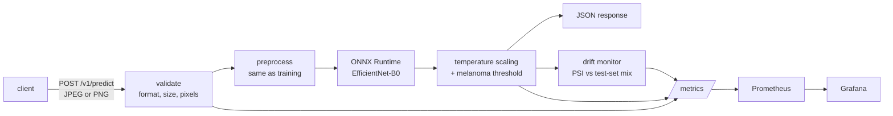

# Lesion classifier service

[](https://github.com/Janat-Yasser/lesion-classifier-service/actions/workflows/ci.yml)

My HAM10000 skin-lesion model, the one from [the leakage study](#where-the-model-comes-from), served as a small
production-style API: an ONNX model behind FastAPI in a Docker container, with tests, CI that builds and
load-tests the container, Prometheus metrics, a Grafana dashboard, and a drift monitor.

> **Not a medical device.** Research demo trained on HAM10000 (CC BY-NC 4.0). Not for diagnosis.



## Run it

```bash
docker build -t lesion-service .
docker run -p 8000:8000 lesion-service
curl -F "file=@lesion.jpg" localhost:8000/v1/predict
```

With monitoring: `docker compose up --build`, then open Grafana at http://localhost:3000. The dashboard shows
requests, p50/p95 latency, the predicted class mix, drift, confidence and input brightness.

Without Docker: `pip install -r requirements.txt && uvicorn app.main:app`.

## API

| | |
|---|---|
| `POST /v1/predict` | One image, multipart field `file`. JPEG or PNG, at most 5 MB (`MAX_UPLOAD_MB`), at least 32 × 32 pixels. |
| `GET /version` | The model card: version, classes, test metrics, data licence, limitations. |
| `GET /v1/drift` | The recent prediction mix compared with the test set (PSI). |
| `GET /health` | Liveness, and whether the model loaded. |
| `GET /metrics` | Prometheus metrics. |

Errors are explicit: `415` for files that aren't JPEG or PNG, `413` for files that are too large,
`422` for empty, undecodable or tiny images. Every response carries an `X-Request-ID`, and every request is
logged as one JSON line.

## Design choices

- **ONNX Runtime, not PyTorch, in the container.** The service needs only `onnxruntime`, not PyTorch,
  which keeps the image small and starts fast. `export/export_onnx.py` refuses to write the model unless
  ONNX Runtime and PyTorch agree on the logits to within 1e-3.
- **Preprocessing identical to training.** A test checks the service's preprocessing against the
  torchvision evaluation transform used in training, to within 1e-5. A silent mismatch here is a classic way
  for a deployed model to underperform its paper.
- **Calibrated output.** Probabilities are temperature-scaled with the temperature chosen on validation,
  and the melanoma flag uses the threshold chosen on validation for 90% specificity. Both come from the
  model card, not from code.
- **The card pins the model.** `model_card.json` stores the SHA-256 of `model.onnx`; the service refuses
  to start if they don't match.
- **Drift without labels.** In production there are no labels, so the service can't see its own
  accuracy. What it can see is the mix of its predictions. The monitor compares the last 500 predictions
  with the mix the model produced on the official test set, using the population stability index.
- **A small, hardened container.** A non-root user, a healthcheck, and a configurable `PORT`, so the same
  image runs on hosts that choose the port.

## Tests and CI

`pytest` (21 tests) covers:
- the API contract and every rejection path
- that a single image and a batch give the same answer
- the temperature behaviour
- refusing a tampered model
- the PSI maths and the drift windows
- preprocessing parity with training

The tests use a tiny stand-in model built by `scripts/make_test_model.py`, so they need no trained weights.

CI then builds the Docker image, starts it with 2 CPUs and 1 GB, waits for the healthcheck, and runs
`scripts/loadtest.py`. The latency table lands in the job summary of every run.

## Where the model comes from

The model is the EfficientNet-B0 from my HAM10000 project, trained with a **lesion-level** split. There,
the common image-level split let repeat photos of the same mole leak into validation, and validation
flattered the model by 13 points on the official test set. The model card (`GET /version`) carries its
official test-set numbers and its limitations.

© 2026 Janat Yasser. All rights reserved.
