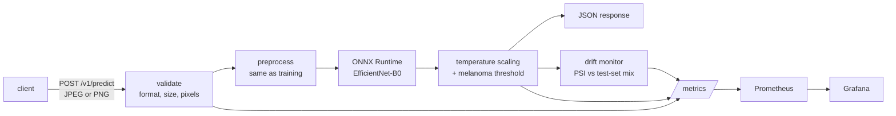

<picture><source media="(prefers-color-scheme: dark)" srcset="assets/banner-dark.svg"></picture>

# lesion-classifier-service

[](https://github.com/Janat-Yasser/lesion-classifier-service/actions/workflows/ci.yml)


The skin-lesion model from my [HAM10000 study](https://github.com/Janat-Yasser/ham10000), taken from a
notebook to something you could actually run: an API that takes a photo and returns a calibrated
prediction, packaged in a container, tested, load-tested in CI, and watched by Prometheus, Grafana and a
drift monitor.

> [!WARNING]
> **Not a medical device.** A research demo trained on HAM10000 (CC BY-NC 4.0). Not for diagnosis.

| | |
|---|---|
| **Model** | EfficientNet-B0, 15.3 MB ONNX, 7 classes, temperature-calibrated |
| **Serving** | FastAPI + ONNX Runtime, CPU only, no PyTorch in the image |
| **Latency** | p50 17 ms, p99 23 ms per image on 2 CPUs; about 58 requests/s |
| **Quality gate** | 21 tests; CI builds the image, waits for the healthcheck and load-tests it |
| **Observability** | Prometheus metrics, a Grafana dashboard, label-free drift (PSI), JSON logs with request ids |

## Quickstart

```bash
docker build -t lesion-service .
docker run -p 8000:8000 lesion-service
curl -F "file=@lesion.jpg" localhost:8000/v1/predict
```

A real response from the shipped model:

```json
{
  "model_version": "ham10000-effnetb0-lesion-20261108",
  "label": "NV",
  "name": "Melanocytic nevus",
  "probability": 0.7527,
  "probabilities": {"MEL": 0.0027, "NV": 0.7527, "BCC": 0.0003, "AKIEC": 0.2383, "BKL": 0.0037, "DF": 0.0018, "VASC": 0.0004},
  "melanoma": {"probability": 0.0027, "threshold": 0.2646, "flag": false},
  "inference_ms": 20.4,
  "disclaimer": "Research demo trained on HAM10000. Not a medical device; not for diagnosis."
}
```

`melanoma.flag` turns on when the melanoma probability passes a threshold chosen on validation data for
90% specificity, so it is a separate alarm from the top label: a photo can be labelled "nevus" and still
raise the flag.

With monitoring: `docker compose up --build`, then open Grafana at http://localhost:3000. Without Docker:
`pip install -r requirements.txt && uvicorn app.main:app`.

## How a request flows



## API

| | |
|---|---|
| `POST /v1/predict` | One image, multipart field `file`. JPEG or PNG, at most 5 MB (`MAX_UPLOAD_MB`), at least 32 × 32 pixels. |
| `GET /version` | The model card: version, classes, test metrics, data licence, limitations. |
| `GET /v1/drift` | The recent prediction mix compared with the test set (PSI). |
| `GET /health` | Liveness, and whether the model loaded. |
| `GET /metrics` | Prometheus metrics. |

Errors are explicit: `415` for files that aren't JPEG or PNG, `413` for files that are too large,
`422` for empty, undecodable or tiny images. Every response carries an `X-Request-ID`, and every request is
logged as one JSON line.

## Operating it

**Metrics** (`GET /metrics`), all scraped by Prometheus and drawn on the Grafana dashboard:

| Metric | What to watch for |
|---|---|
| `lesion_requests_total{endpoint,status}` | a rise in `4xx` means clients send bad files; any `5xx` is a bug |
| `lesion_request_seconds` | p95 creeping up under steady traffic means the CPU is saturated |
| `lesion_predictions_total{label}` | the class mix; a sudden change is the first sign of new kinds of input |
| `lesion_confidence` | a slide toward low confidence means the inputs look unfamiliar |
| `lesion_input_brightness` | a shift usually means a different camera or lighting, not different patients |
| `lesion_prediction_psi` | the drift score below |

**Drift, without labels.** In production nobody tells the service whether it was right, so it can't watch
its accuracy. It *can* watch what it predicts. `GET /v1/drift` compares the last 500 predictions with the
class mix the model produced on the official test set, using the population stability index:

| PSI | Status | What to do |
|---|---|---|
| below 0.1 | `stable` | nothing |
| 0.1 to 0.25 | `worth a look` | check the brightness and confidence panels; sample a few inputs |
| above 0.25 | `shifted` | the inputs no longer look like the training data; label a sample and re-evaluate before trusting the scores |

Under 50 predictions it reports `not enough data` rather than a noisy number.

## Load test

The real model on a 2-core machine, ONNX Runtime on CPU, one image per request (`scripts/loadtest.py`):

| concurrency | p50 ms | p95 ms | p99 ms | requests/s | errors |
|---|---|---|---|---|---|
| 1 | 17 | 21 | 23 | 57.5 | 0 / 300 |
| 4 | 68 | 83 | 86 | 57.8 | 0 / 400 |

Throughput stays at about 58 requests/s while latency grows with concurrency, so 2 cores are the
bottleneck: requests queue rather than fail. More throughput means more replicas, not more concurrency.

## Decisions, and why

- **ONNX Runtime, not PyTorch, in the container.** The service needs only `onnxruntime`, not PyTorch,
  which keeps the image small and starts fast. `export/export_onnx.py` refuses to write the model unless
  ONNX Runtime and PyTorch agree to within 1e-3 on the logits and 1e-4 on the probabilities, on image-like
  inputs. (On pure Gaussian noise this network's logits pass ±100, where float32 rounding alone reaches
  1e-2, so noise is a misleading test input.) For the shipped model the largest difference is 9e-6.
- **Preprocessing identical to training.** A test checks the service's preprocessing against the
  torchvision evaluation transform used in training, to within 1e-5. A silent mismatch here is a classic way
  for a deployed model to underperform its paper.
- **Calibrated output.** Probabilities are temperature-scaled with the temperature chosen on validation,
  and the melanoma flag uses the threshold chosen on validation for 90% specificity. Both come from the
  model card, not from code.
- **The card pins the model.** `model_card.json` stores the SHA-256 of `model.onnx`; the service refuses
  to start if they don't match.
- **Drift without labels.** In production there are no labels, so the service can't see its own
  accuracy. What it can see is the mix of its predictions. The monitor compares the last 500 predictions
  with the mix the model produced on the official test set, using the population stability index.
- **A small, hardened container.** A non-root user, a healthcheck, and a configurable `PORT`, so the same
  image runs on hosts that choose the port.

## The model

EfficientNet-B0 (15.3 MB as ONNX) from my [HAM10000 project](https://github.com/Janat-Yasser/ham10000),
trained with a **lesion-level** split, seed 42. Official ISIC 2018 test set, 1,512 images:

| | |
|---|---|
| Balanced accuracy | 0.744 (95% CI 0.704–0.780) |
| Macro AUC | 0.960 |
| Melanoma AUC | 0.922 |
| Melanoma flag (threshold chosen on validation) | sensitivity 0.795, specificity 0.890 |
| Calibration error (ECE) after temperature scaling | 0.014 (0.084 before) |

Why the lesion split: HAM10000 has several photos of many moles. With the usual image-level split those
repeats leak into validation, and across three seeds validation overstated test balanced accuracy by
13.7 points, against 4.8 with the lesion split. About a quarter of test melanomas are still called benign
nevi, which is the main reason the card says research only.

## Tests and CI

`pytest` (21 tests) covers:
- the API contract and every rejection path
- that a single image and a batch give the same answer
- the temperature behaviour
- refusing a tampered model
- the PSI maths and the drift windows
- preprocessing parity with training

The tests use a tiny stand-in model built by `scripts/make_test_model.py`, so they need no trained weights.

CI then builds the Docker image, starts it with 2 CPUs and 1 GB, waits for the healthcheck, and runs
`scripts/loadtest.py`. The latency table lands in the job summary of every run.

© 2026 Janat Yasser. All rights reserved.
